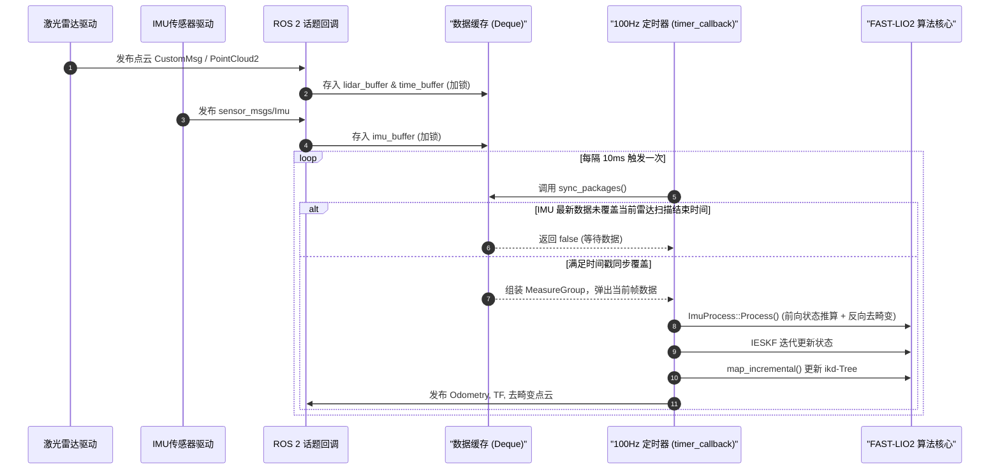

# 01. 系统架构与 ROS 2 数据流

本章节详细剖析 FAST-LIO2 在 ROS 2 架构下的软件实现，涵盖节点生命周期、多传感器时间戳同步机制、坐标系命名规范以及参数配置说明。

---

## 1. 系统总体架构与节点设计

在 `FAST_LIO_ROS2` 中，核心里程计与建图逻辑被封装在单一 ROS 2 节点类 `LaserMappingNode`（位于 [src/laserMapping.cpp](../src/laserMapping.cpp#L796)）中。

### 1.1 节点运行模型与线程调度
不同于 ROS 1 中常见的“回调函数内阻塞等待”或“独立线程 `while(ros::ok())` 死循环”，本项目基于 ROS 2 的标准执行器（Executor）与定时器机制：

1. **单线程执行器**：
   在 `main` 函数（[src/laserMapping.cpp#L1157-L1198](../src/laserMapping.cpp#L1157-L1198)）中通过 `rclcpp::spin(std::make_shared<LaserMappingNode>())` 启动。
2. **多传感器异步接收**：
   LiDAR 回调（`livox_pcl_cbk` 或 `standard_pcl_cbk`）和 IMU 回调（`imu_cbk`）分别异步接收数据，并在互斥锁 `mtx_buffer` 保护下将数据存入双端队列 `lidar_buffer` 和 `imu_buffer`。
3. **主处理定时器 (`timer_`)**：
   设置高频定时器（100 Hz，即 10 ms 周期，[src/laserMapping.cpp#L939-L940](../src/laserMapping.cpp#L939-L940)），每次触发时调用 `timer_callback()`，尝试通过 `sync_packages(Measures)` 对齐时间包并驱动一帧算法运行。
4. **低频地图发布定时器 (`map_pub_timer_`)**：
   设置 1 Hz 定时器（1000 ms，[src/laserMapping.cpp#L942-L943](../src/laserMapping.cpp#L942-L943)），以避免频繁序列化全局大点云导致通信阻塞。



---

## 2. 话题接口与服务定义

### 2.1 订阅话题 (Subscriptions)

| 话题名称 | 消息类型 | 对应参数 | 说明 |
| :--- | :--- | :--- | :--- |
| `common.lid_topic`<br/>(默认 `/livox/lidar`) | `livox_ros_driver2::msg::CustomMsg`<br/>或 `sensor_msgs::msg::PointCloud2` | `preprocess.lidar_type` | 若为 `AVIA`（1），订阅 Livox 定制驱动消息；若为 Velodyne/Ouster/Mid360 等，采用 SensorDataQoS 订阅通用 `PointCloud2` |
| `common.imu_topic`<br/>(默认 `/livox/imu`) | `sensor_msgs::msg::Imu` | - | 原始惯导数据，要求输出角速度（rad/s）与线加速度（$\text{m/s}^2$） |

### 2.2 发布话题 (Publishers)

| 话题名称 | 消息类型 | Frame ID | 说明 |
| :--- | :--- | :--- | :--- |
| `/Odometry` | `nav_msgs::msg::Odometry` | `camera_init` (父)<br/>`body` (子) | 包含 6-DOF 位姿和由 IESKF 协方差估计出的位姿不确定度 |
| `/path` | `nav_msgs::msg::Path` | `camera_init` | 历史运动轨迹（每 10 帧抽样发布一次以防止 RViz 崩溃） |
| `/cloud_registered` | `sensor_msgs::msg::PointCloud2` | `camera_init` | 当前帧去畸变并转换至世界坐标系下的点云（全量或降采样） |
| `/cloud_registered_body`| `sensor_msgs::msg::PointCloud2` | `body` | 当前帧去畸变后转换至 IMU 载体坐标系下的点云 |
| `/cloud_effected` | `sensor_msgs::msg::PointCloud2` | `camera_init` | 成功匹配到地图平面并参与残差构建的有效特征点云 |
| `/Laser_map` | `sensor_msgs::msg::PointCloud2` | `camera_init` | 全局累计局部地图点云（由低频定时器按需触发） |

### 2.3 TF 变换广播与服务 (Services)
- **TF 变换**：广播 `camera_init` $\rightarrow$ `body` 的动态变换（见 [src/laserMapping.cpp#L647-L659](../src/laserMapping.cpp#L647-L659)）。
- **地图保存服务**：
  - 服务名：`map_save` (`std_srvs::srv::Trigger`)。
  - 功能：运行时触发点云保存至 `map_file_path` 指定的 PCD 文件路径。

---

## 3. 多传感器数据同步机制 (`sync_packages`)

数据对齐是整个 SLAM 算法稳健运行的前提。FAST-LIO2 属于松/紧耦合中的紧耦合迭代卡尔曼滤波，**需要当前雷达帧扫描周期内部所有的 IMU 采样序列来完成运动补偿**。

### 3.1 时间切片逻辑
函数 `sync_packages(MeasureGroup &meas)` 实现于 [src/laserMapping.cpp#L383-L435](../src/laserMapping.cpp#L383-L435)：

```cpp
bool sync_packages(MeasureGroup &meas)
{
    if (lidar_buffer.empty() || imu_buffer.empty()) {
        return false;
    }

    /*** 1. 弹出激光雷达帧头部，计算该帧结束时间 ***/
    if(!lidar_pushed)
    {
        meas.lidar = lidar_buffer.front();
        meas.lidar_beg_time = time_buffer.front();
        
        // 关键点：点云最后一个点的 curvature 存储了相对该帧起始时间的偏移量（单位：ms）
        if (meas.lidar->points.size() <= 1) {
            lidar_end_time = meas.lidar_beg_time + lidar_mean_scantime;
        } else if (meas.lidar->points.back().curvature / double(1000) < 0.5 * lidar_mean_scantime) {
            lidar_end_time = meas.lidar_beg_time + lidar_mean_scantime;
        } else {
            scan_num ++;
            lidar_end_time = meas.lidar_beg_time + meas.lidar->points.back().curvature / double(1000);
            lidar_mean_scantime += (meas.lidar->points.back().curvature / double(1000) - lidar_mean_scantime) / scan_num;
        }
        meas.lidar_end_time = lidar_end_time;
        lidar_pushed = true;
    }

    /*** 2. 检查 IMU 最新时间戳是否完全覆盖雷达扫描结束时间 ***/
    if (last_timestamp_imu < lidar_end_time)
    {
        // IMU 数据尚未到齐，退出等待下一周期
        return false;
    }

    /*** 3. 抽取该雷达帧时间窗口内的所有 IMU 数据 ***/
    double imu_time = get_time_sec(imu_buffer.front()->header.stamp);
    meas.imu.clear();
    while ((!imu_buffer.empty()) && (imu_time < lidar_end_time))
    {
        imu_time = get_time_sec(imu_buffer.front()->header.stamp);
        if(imu_time > lidar_end_time) break;
        meas.imu.push_back(imu_buffer.front());
        imu_buffer.pop_front();
    }

    lidar_buffer.pop_front();
    time_buffer.pop_front();
    lidar_pushed = false;
    return true;
}
```

> [!IMPORTANT]
> **关键细节：`last_imu_` 跨帧缝合**
> 在 `UndistortPcl`（[src/IMU_Processing.hpp#L216-L217](../src/IMU_Processing.hpp#L216-L217)）中，算法强制将**上一雷达帧最后保留的一个 IMU 测量值**插入到当前帧 IMU 队列头部：`v_imu.push_front(last_imu_)`。这确保了前后两个雷达帧之间的 IMU 前向积分在时间轴上严丝合缝，没有一微秒的积分断层。

---

## 4. 坐标系定义与位姿转换链

系统涉及三个主要坐标系，符号与定义如下：

```
       [camera_init] (世界坐标系 / World Frame, W)
             |
             |  T_W_I = (R, p)  <-- 由 IESKF 实时估计并维护的主状态
             v
          [body] (IMU 载体坐标系 / IMU Frame, I)
             |
             |  T_I_L = (offset_R_L_I, offset_T_L_I) <-- 外参 (可固定或在线自标定)
             v
         [lidar] (激光雷达原点坐标系 / LiDAR Frame, L)
```

1. **`camera_init` ($W$)**：
   全局世界参考系，以第一帧系统初始化时的 IMU 位置为原点，重力方向与 $Z$ 轴反向对齐。
2. **`body` ($I$)**：
   IMU 敏感元件中心坐标系。系统的核心位姿状态 $p \in \mathbb{R}^3$ 和旋转 $R \in SO(3)$ 均描述的是载体坐标系 $I$ 在世界坐标系 $W$ 下的位置与朝向。
3. **`lidar` ($L$)**：
   激光发射与测距物理中心。任一激光反射点原始测量值记为 ${}^L p = (x_L, y_L, z_L)^T$。

### 坐标变换通用公式
点从雷达系转换到世界系的严密公式为：
$${}^W p = R \cdot \left( R_L^I \cdot {}^L p + p_L^I \right) + p$$

对应源码中的工具函数 `pointBodyToWorld`（[src/laserMapping.cpp#L182-L191](../src/laserMapping.cpp#L182-L191)）：
```cpp
void pointBodyToWorld(PointType const * const pi, PointType * const po)
{
    V3D p_body(pi->x, pi->y, pi->z);
    V3D p_global(state_point.rot * (state_point.offset_R_L_I * p_body + state_point.offset_T_L_I) + state_point.pos);
    po->x = p_global(0);
    po->y = p_global(1);
    po->z = p_global(2);
    po->intensity = pi->intensity;
}
```

---

## 5. YAML 配置文件核心参数深度解读

以 [config/avia.yaml](../config/avia.yaml) 为例，开发中必须了解的参数定义如下：

| 参数项 | 默认值 | 推荐修改场景与工程注意事项 |
| :--- | :--- | :--- |
| `common.lid_topic` | `/livox/lidar` | 需与传感器驱动发布的雷达话题保持一致 |
| `common.imu_topic` | `/livox/imu` | 需与 IMU 驱动发布的惯导话题保持一致 |
| `common.time_sync_en` | `false` | 若雷达与 IMU 采用硬件 PTP/PPS 授时，必须设为 `false`；若无硬件对时且两传感器时间戳存在秒级偏差，才设为 `true` 开启自同步 |
| `preprocess.blind` | `4.0` / `0.5` | 近距离盲区距离阈值（单位：米）。雷达自身结构件遮挡时必须加大此参数，防止近处杂波拉偏状态 |
| `preprocess.point_filter_num` | `3` | 点云降采样抽样率，每隔 N 个点保留 1 个。算力受限时可调大（如设为 4 或 5）以减轻匹配压力 |
| `max_iteration` | `3` 或 `4` | IESKF 每次更新的最大 Gauss-Newton 迭代轮数。通常 3~4 次即可完全收敛 |
| `filter_size_surf` | `0.5` | 当前帧特征点下采样体素大小（米）。室外通常为 0.4~0.5，精密室内建图可设为 0.1~0.2 |
| `filter_size_map` | `0.5` | ikd-Tree 地图点云插入时的下采样体素大小 |
| `cube_side_length` | `1000.0` | 局部地图滑动窗口有效范围（米）。超出雷达周围该尺寸的远端地图点会被 ikd-Tree 动态剔除以释放内存 |
| `mapping.acc_cov` | `0.1` | 加速度计高斯白噪声方差。振动工况（无人机/装甲车）应适当增大此项 |
| `mapping.gyr_cov` | `0.1` | 陀螺仪高斯白噪声方差 |
| `mapping.b_acc_cov` | `0.0001` | 加速度计随机游走零偏协方差 |
| `mapping.b_gyr_cov` | `0.0001` | 陀螺仪随机游走零偏协方差 |
| `mapping.extrinsic_est_en` | `false`/`true` | 是否在线自估计外参 $R_L^I, p_L^I$。如果已有精密离线标定结果，强烈建议设为 `false` 以节约 6 维自由度带来的潜在发散风险 |
| `mapping.extrinsic_T` | `[x, y, z]` | 平移外参 $p_L^I$，雷达在 IMU 坐标系下的坐标 |
| `mapping.extrinsic_R` | 9维矩阵 | 旋转外参 $R_L^I$，雷达在 IMU 坐标系下的旋转矩阵 |

---

## 6. 系统生命周期总结

1. **节点加载**：解析 ROS 2 参数、初始化滤波状态维度；
2. **初始化阶段（前 10 帧数据，`init_iter_num <= 10`）**：
   - 系统要求静止放置，计算加速度均值以对齐重力方向；
   - 估算初始陀螺零偏，设置初始滤波状态；
3. **稳定跟踪阶段**：
   - 100 Hz 检查数据对齐；
   - 执行前向推算与点云反向去畸变；
   - 基于 ikd-Tree 检索 5 近邻平面并计算残差；
   - IESKF 更新状态与外参；
   - 增量式维护 ikd-Tree 地图并发布里程计；
4. **节点终止**：捕获 `SIGINT` 信号，调用 `save_to_pcd()` 将待保存点云持久化至硬盘，关闭所有日志句柄。
