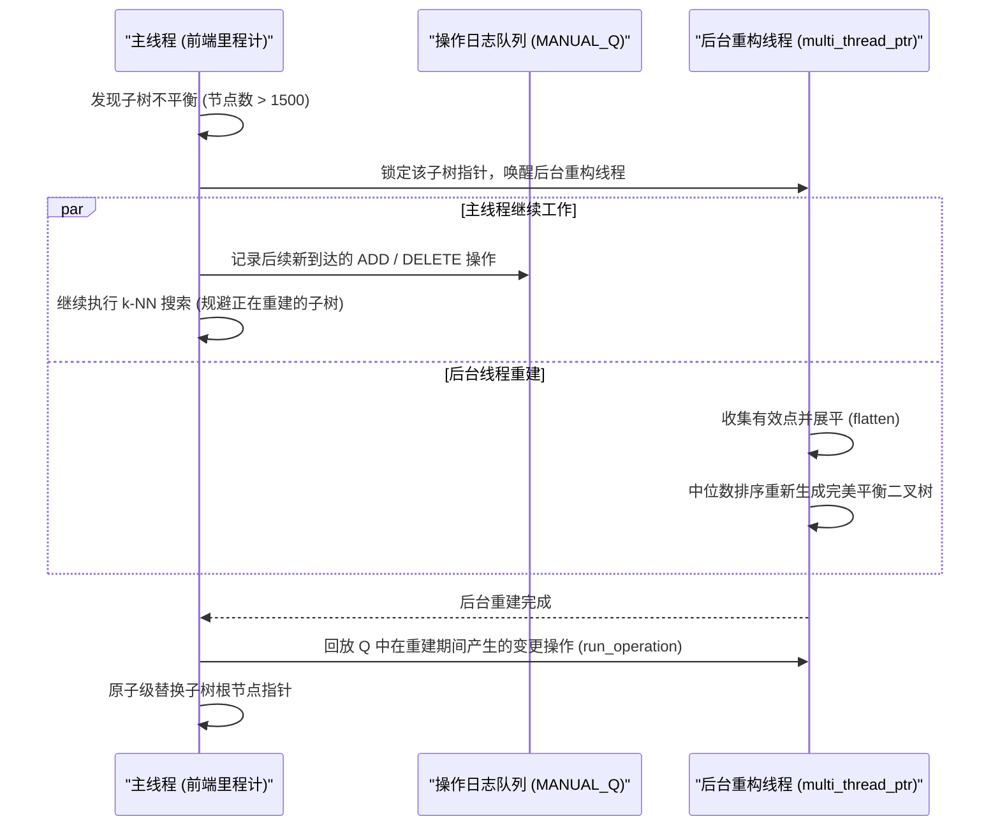

# 05. ikd-Tree 动态数据结构剖析

在 3D SLAM 中，最近邻搜索（k-NN）通常占据了 40% 以上的计算时间。传统 KD-Tree（如 `nanoflann` 或 PCL 中的 `pcl::KdTreeFLANN`）属于**静态数据结构**，不支持增量更新；一旦有新地图点产生或旧点需要剔除，就必须在后台重新全量建树（复杂度为 $O(N \log N)$），极易引发掉帧。

FAST-LIO2 的最大突破之一就是提出了 **ikd-Tree（Incremental KD-Tree）**。它直接省去了复杂的点云特征提取与多层滑窗优化，使得系统能够直接维护百万级别的全量稠密地图。

本章节深度解析 ikd-Tree 位于 [include/ikd-Tree/ikd_Tree.h](../include/ikd-Tree/ikd_Tree.h) 与 [include/ikd-Tree/ikd_Tree.cpp](../include/ikd-Tree/ikd_Tree.cpp) 的源码实现。

---

## 1. ikd-Tree 节点与核心结构体

ikd-Tree 是一个带有**增强属性（Augmented Attributes）**与**惰性标记（Lazy Labels）**的二叉搜索树。

### 1.1 节点定义 (`KD_TREE_NODE`)
在 [include/ikd-Tree/ikd_Tree.h#L59-L82](../include/ikd-Tree/ikd_Tree.h#L59-L82) 中：

```cpp
struct KD_TREE_NODE
{
    PointType point;               // 存储的三维点数据 (x, y, z)
    int division_axis;             // 当前节点的空间划分轴向 (0:X, 1:Y, 2:Z)
    int TreeSize = 1;              // 以此节点为根的子树所有节点总数 (包含已删节点)
    int invalid_point_num = 0;     // 子树中被标记为已删除的节点总数
    
    // 惰性删除标记 (Lazy Deletion Flags)
    bool point_deleted = false;    // 当前点本身是否被标记删除
    bool tree_deleted = false;     // 整棵子树是否被标记删除
    bool point_downsample_deleted = false;
    bool tree_downsample_deleted = false;
    
    // 轴对齐包围盒 (Axis-Aligned Bounding Box, AABB)
    float node_range_x[2];         // [X_min, X_max]
    float node_range_y[2];         // [Y_min, Y_max]
    float node_range_z[2];         // [Z_min, Z_max]
    
    KD_TREE_NODE *left_son_ptr = nullptr;
    KD_TREE_NODE *right_son_ptr = nullptr;
    KD_TREE_NODE *father_ptr = nullptr;
};
```

### 1.2 增强属性的关键作用
1. **包围盒范围 (`node_range`)**：
   维护了子树中所有点在空间上的外接长方体边界。在最近邻搜索时，算法首先计算待查点到该包围盒的最短欧氏距离 `calc_box_dist`；若包围盒的最短距离已大于当前堆中的最差距离，**整棵子树即可直接剪枝剪掉**！
2. **容量与删除计数 (`TreeSize`, `invalid_point_num`)**：
   用于在常数时间 $O(1)$ 内评估子树的平衡度与无效节点比例，以判断是否需要触发树的动态重构。

---

## 2. 动态平衡与重平衡判据

为了在频繁插入新点和删除旧点后，依然将树的高度严格维持在 $O(\log N)$，ikd-Tree 提出了两项自平衡判据：

```
                [Root]
               /      \
        [Left Sub]   [Right Sub]
```

### 2.1 平衡度判据（$\alpha$-Balanced Criterion）
当子树左右两侧规模严重不对称时触发重构。
定义平衡因子：
$$\alpha_{bal} = \frac{\max\left( \mathrm{Size}(Left), \mathrm{Size}(Right) \right)}{\mathrm{Size}(Node)}$$
默认阈值设为 $\alpha_{bal\_max} = 0.7$（源码中参数 `balance_criterion_param = 0.7f`）。
- 若 $\alpha_{bal} > 0.7$，说明左或右子树倾斜过甚，搜索深度退化，必须对该子树执行扁平化重建。

### 2.2 惰性删除比率判据（$\alpha$-Deleted Criterion）
如果一棵子树中包含过多由于惰性删除产生的无效空节点，树的高度会虚高。
定义无效节点占比：
$$\alpha_{del} = \frac{\mathrm{InvalidPoints}(Node)}{\mathrm{Size}(Node)}$$
默认阈值设为 $\alpha_{del\_max} = 0.5$（`delete_criterion_param = 0.5f`）。
- 若 $\alpha_{del} > 0.5$，说明有一半以上的节点已被废弃，必须触发就地重构以彻底释放这些内存，缩减树高。

---

## 3. 点云增量插入与就地下采样 (`Add_Points`)

在建图过程中，当前帧点云需要被不断追加进全局地图中。ikd-Tree 提供了带空间体素下采样的插入模式（`downsample_on = true`，见 [src/laserMapping.cpp#L481](../src/laserMapping.cpp#L481)）。

### 3.1 空间体素下采样插入原理
假设地图体素边长为 $s$（`filter_size_map`，如 0.5 m）：
1. 任一新待插入点 $P(x, y, z)$ 所属的体素几何中心 $P_{mid}$ 为：
   $$P_{mid} = \left( \lfloor x/s \rfloor \cdot s + 0.5s, \lfloor y/s \rfloor \cdot s + 0.5s, \lfloor z/s \rfloor \cdot s + 0.5s \right)$$
2. 在 ikd-Tree 中检查该体素内是否已有已存地图点：
   - 若该体素内无点，直接插入新点 $P$；
   - 若该体素内已存在若干点，计算这些点以及新点 $P$ 距离体素中心 $P_{mid}$ 的距离；
   - **仅保留距离中心 $P_{mid}$ 最近的那个点**！
   - 若新点更近，则通过 `Delete_by_point` 将旧点标记删除，再插入新点。

这样保证了地图中的点云在三维空间中保持完全均匀的体素密度，既防止了点云爆炸，又避免了反复调用全局降采样滤波器的额外开销。

---

## 4. 空间包围盒删除 (`Delete_Point_Boxes`)

在车辆移动时，超出当前 FOV 视场或超出滑动窗口范围（`cube_side_length`）的旧地图点需要被剔除。
ikd-Tree 支持批量长方体区域（Box）删除：

```
待删除区域 Box: [x_min, x_max] x [y_min, y_max] x [z_min, z_max]
```

### 4.1 层次化惰性删除算法
遍历子树节点，比较子树 AABB 包围盒与待删除长方体 Box 的几何相交关系：
1. **完全包含（Box 包含子树 AABB）**：
   直接将该节点的 `tree_deleted` 标记为 `true`，`invalid_point_num` 设为 `TreeSize`。
   **无需遍历子树内部任何一个后代节点！时间复杂度直接降为 $O(1)$**！
2. **完全分离（Box 与子树 AABB 无交集）**：
   直接剪枝跳过整个子树，无需任何操作。
3. **部分相交（Box 与子树 AABB 局部重叠）**：
   - 检查当前节点自身是否落在 Box 内，若是，标记 `point_deleted = true`；
   - 分别递归进入左右子树执行删除；
   - 回溯时更新父节点的 `TreeSize`、包围盒与删除计数，并检查是否违反自平衡判据。

### 4.2 标记下推机制 (`Push_Down`)
类似线段树中的 Lazy Tag，如果某节点的 `tree_deleted` 为 `true`，其后代节点并未立即更新。当后续的最近邻搜索遍历进入此节点时，调用 `Push_Down` 函数（[include/ikd-Tree/ikd_Tree.cpp](../include/ikd-Tree/ikd_Tree.cpp)），将删除标记传递给直接子节点，确保搜索一致性。

---

## 5. 双线程异步并行重构机制

当某棵大型子树（例如包含上万个点）违反平衡判据时，若在主线程中同步重新建树，可能引发 10~20 ms 的阻塞，破坏系统的实时性。

ikd-Tree 设计了**前后台双线程机制**：



### 关键组件
1. **轻量无锁环形队列 `MANUAL_Q Rebuild_Logger`**（[include/ikd-Tree/ikd_Tree.h#L203-L255](../include/ikd-Tree/ikd_Tree.h#L203-L255)）：
   主线程在后台线程建树期间，将所有增、删请求包装为 `Operation_Logger_Type` 追加到此循环队列中；
2. **操作回放机制 (`run_operation`)**：
   新树生成后，主线程重放重建期间积攒的所有日志，使新树的状态同步追平当前时刻，最后完成指针替换。

---

## 6. 最近邻搜索算法与剪枝策略 (`Nearest_Search`)

在 [include/ikd-Tree/ikd_Tree.cpp](../include/ikd-Tree/ikd_Tree.cpp) 中，`Nearest_Search` 配合手写最大堆 `MANUAL_HEAP`（[include/ikd-Tree/ikd_Tree.h#L111-L201](../include/ikd-Tree/ikd_Tree.h#L111-L201)）执行：

```cpp
void KD_TREE<PointType>::Search(KD_TREE_NODE *root, int k_nearest, 
                                PointType point, MANUAL_HEAP &q, float max_dist)
```

### 剪枝优化步骤
1. 若 `root == nullptr` 或 `root->tree_deleted == true`，直接返回；
2. 计算查询点 `point` 到当前节点包围盒的距离 `box_dist = calc_box_dist(root, point)`：
   - 若堆中已满 $k$ 个候选点，且 `box_dist >= q.top().dist`，**直接返回并剪除整棵子树**；
3. 若当前节点未被删除（`!root->point_deleted`），计算其与查询点的欧氏距离：
   - 若距离小于堆顶最差距离，弹出堆顶并压入该点；
4. 计算查询点沿当前划分轴 `division_axis` 到分割平面的有符号距离，优先搜索靠近查询点一侧的子树，回溯时再根据包围盒距离决定是否搜索另一侧。
