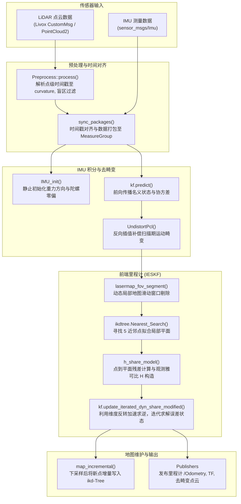

# FAST-LIO2 算法原理与代码实现全解析

欢迎阅读本项目（`FAST_LIO_ROS2`）的深度技术文档。本套文档旨在为算法研究人员和工程开发人员提供一份**从连续时间数学建模、流形误差状态滤波理论，到 ROS 2 源码级工程实现与二次开发**的完整参考手册。

---

## 目录导航

| 章节文档 | 核心内容概述 |
| :--- | :--- |
| **[01. 系统架构与 ROS 2 数据流](01_system_overview_and_ros2_pipeline.md)** | 系统总体拓扑、ROS 2 节点设计、多传感器时间戳同步（`sync_packages`）、全局/局部坐标系定义与参数配置详解 |
| **[02. 数学基础与 IESKF 滤波理论](02_mathematical_principles.md)** | 流形与李代数定义（$\mathcal{M}=SO(3)\times\mathbb{R}^3\times S^2\dots$）、连续/离散误差状态运动学方程、点面残差几何模型、观测雅可比推导与核心矩阵求逆加速技巧 |
| **[03. IMU 处理与点云畸变补偿](03_imu_processing_and_undistortion.md)** | 静态重力与零偏初始化（`IMU_init`）、前向状态积分、反向运动补偿去畸变（`UndistortPcl`）数学推导与代码比对 |
| **[04. 激光雷达点云预处理模块](04_pointcloud_preprocess.md)** | Livox (Avia/Mid360)、Velodyne、Ouster 多雷达协议适配机制、利用 `curvature` 字段隐式传递点级微秒时间戳的工程实现、盲区过滤 |
| **[05. ikd-Tree 动态数据结构剖析](05_ikd_tree_design_and_algorithms.md)** | 动态增量式 KD-Tree 树结构、惰性标签（Lazy Deletion）、$\alpha$ 平衡与删除重构判据、双线程异步重构（`Operation_Logger_Type`）与最近邻搜索 |
| **[06. IKFoM 流形滤波框架深度解析](06_iterated_kalman_filter_ikfom.md)** | `IKFoM_toolkit` 元编程宏机制（`MTK_BUILD_MANIFOLD`）、切空间 $\boxplus / \boxminus$ 运算、迭代滤波更新循环（`update_iterated_dyn_share_modified`）源码剖析 |
| **[07. 二次开发与代码扩展实战指南](07_code_modification_and_extension_guide.md)** | 如何修改状态向量、如何融合外部传感器（轮速计/GNSS/气压计）、点面残差改进、坐标系转换避坑指南与 Eigen 内存对齐要点 |

---

## 快速概览：FAST-LIO2 核心流程

---

## 核心源码文件索引

| 文件路径 | 对应核心功能 | 关键函数/类 |
| :--- | :--- | :--- |
| [`src/laserMapping.cpp`](../src/laserMapping.cpp) | ROS 2 主节点、主循环、残差与雅可比计算、地图维护 | `LaserMappingNode`, `h_share_model`, `sync_packages`, `map_incremental` |
| [`src/IMU_Processing.hpp`](../src/IMU_Processing.hpp) | IMU 预积分、名义状态推算、反向运动补偿 | `ImuProcess::Process`, `IMU_init`, `UndistortPcl` |
| [`src/preprocess.cpp`](../src/preprocess.cpp) / [`.h`](../src/preprocess.h) | 多款 LiDAR 原始点云解析与时间归一化 | `Preprocess::process`, `avia_handler`, `velodyne_handler` |
| [`include/use-ikfom.hpp`](../include/use-ikfom.hpp) | 23 维状态流形定义、系统状态转移矩阵与噪声设置 | `state_ikfom`, `get_f`, `df_dx`, `df_dw` |
| [`include/IKFoM_toolkit/esekfom/esekfom.hpp`](../include/IKFoM_toolkit/esekfom/esekfom.hpp) | 通用流形迭代误差状态卡尔曼滤波器模板类 | `esekf::update_iterated_dyn_share_modified`, `predict` |
| [`include/ikd-Tree/ikd_Tree.cpp`](../include/ikd-Tree/ikd_Tree.cpp) / [`.h`](../include/ikd-Tree/ikd_Tree.h) | 增量式 KD 树实现（增、删、查、动态重平衡） | `KD_TREE::Add_Points`, `Delete_Point_Boxes`, `Nearest_Search` |
| [`include/common_lib.h`](../include/common_lib.h) | 基础几何结构体、平面拟合工具、ROS 2 时间转换辅助 | `esti_plane`, `MeasureGroup`, `set_pose6d` |
| [`include/so3_math.h`](../include/so3_math.h) | $SO(3)$ 旋转指数映射、对数映射与反对称矩阵宏 | `Exp`, `Log`, `SKEW_SYM_MATRX` |

---

## 为什么需要仔细阅读源码细节？

在实际工程应用中，针对特定任务的改进（例如引入轮速计约束、在微型无人机上运行轻量级版本、在强振动工况下抗震动漂移、适配自研新型固态雷达）往往需要触及以下关键技术节点：
1. **状态变量维数与雅可比矩阵块对齐**：修改状态量或观测模型时，必须严格保证切空间自由度、李代数伴随变换以及分块矩阵尺寸一致；
2. **点云时间戳定义规范**：FAST-LIO2 深度依赖点级相对时间戳（单位统一为毫秒并保存在 `curvature` 字段），如果雷达驱动输出的相对时间戳格式不对，会导致运动畸变矫正严重错误；
3. **坐标系变换传递链**：LiDAR 坐标系（`body_lidar`）、IMU 坐标系（`body`）以及世界坐标系（`camera_init`）之间的外参补偿及协方差变换。

建议按照文档序列依次研读，或直接按章节跳转至需要修改的模块。
